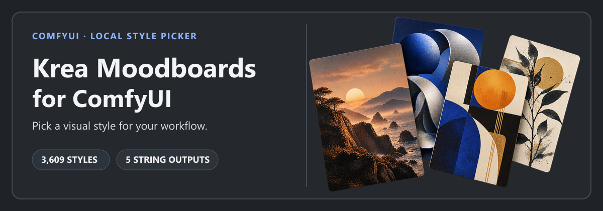

# ComfyUI Krea Moodboards Local



<p align="center"><strong>English</strong> · <a href="./README.zh.md">简体中文</a></p>

Browse and select visual styles from inside ComfyUI, then pass their prompt guidance to your workflow. The bundled catalogs contain **3,549 Krea moodboards** and **60 Andro.Meta curated styles**.

[Original project: Andro-Meta/ComfyUI-Krea-Moodboards](https://github.com/Andro-Meta/ComfyUI-Krea-Moodboards) · [Krea moodboard gallery](https://www.krea.ai/app?gallery=moodboards) · [Data notice](./DATA_NOTICE.md)

Built for the moodboard step in [ComfyUI-Krea2-Harness workflows](https://github.com/ANe5s/ComfyUI-Krea2-Harness/blob/main/README.md), with ComfyUI i18n support in English and Simplified Chinese.

The cover artwork is illustrative. It is not a catalog thumbnail or a screenshot of the node.

## Features

- Search the catalog, filter by style family, and load more results as you browse.
- Pick a random style from the current search and filter, or save styles to favorites in your browser.
- The interface follows ComfyUI's language setting and supports i18n in English and Simplified Chinese. Simplified Chinese titles and summaries for all 3,609 catalog cards are bundled; selected styles keep their original English names.
- Browse the bundled catalogs without installing the upstream project or additional Python packages.

## Requirements

| Scope | Requirements |
| --- | --- |
| This moodboard browser | A working ComfyUI custom-node installation; no additional Python packages. |
| Krea2 Harness examples | Python 3.10+, ComfyUI 0.3.0+, and a ComfyUI build with `TextGenerate` support for the required Qwen3-VL model. |
| Standard text-to-image example | Krea 2 Turbo diffusion model, Qwen3-VL text encoder, and Qwen Image VAE. Workflow notes list any additional models or extensions. |

The Python and ComfyUI minimum versions above are documented by the Harness project. This browser plugin does not declare separate minimum versions.

## Installation

From the ComfyUI installation directory, install this plugin with:

```bash
cd ComfyUI/custom_nodes
git clone https://github.com/ANe5s/ComfyUI-Krea-Moodboards-Local.git
```

To use the Harness workflows, install `ComfyUI-Krea2-Harness` separately in the same `custom_nodes` directory:

```bash
git clone https://github.com/ANe5s/ComfyUI-Krea2-Harness.git
```

For a manual install, copy each complete folder into `ComfyUI/custom_nodes/`. The local plugin folder containing `__init__.py` should be `ComfyUI/custom_nodes/ComfyUI-Krea-Moodboards-Local/`.

Keep the `data/`, `locales/`, and `web/` directories, then fully restart ComfyUI. Find **Krea Moodboard Visual Browser** under **ANe5s Nodes / Krea2**.

## Quick start

1. Load a Krea2 Harness example workflow from its `examples/` folder.
2. Search or filter styles in **Krea Moodboard Visual Browser**, select a card or choose a random style, and set `strength` to `concise`, `normal`, or `strong`.
3. Connect `positive`, `title`, `uuid`, and `metadata_json` to **Krea2 Moodboard Adapter**. Connect `negative` directly to the downstream negative text encoder.
4. Load the model files listed in the selected workflow's notes, then queue the workflow.

The node returns `STRING` values only. It does not load a model, generate images, or output conditioning.

### Outputs

| Output | Type | Contents |
| --- | --- | --- |
| `positive` | `STRING` | Positive style guidance |
| `negative` | `STRING` | Negative style guidance |
| `title` | `STRING` | Original style title |
| `uuid` | `STRING` | Style UUID |
| `metadata_json` | `STRING` | Style metadata, including source information |

## Local data and thumbnails

The catalog, translations, and browser API are local. Browsing does not send requests to Krea, its CDN, or translation services. Thumbnails are read from the local `data/thumb_cache/` directory and are not downloaded automatically. Styles remain searchable and selectable when a thumbnail is missing, but their cards will not show that image. Preserve the cache directory if you already have it and need those thumbnails offline. Opening a Krea source link in a card launches that public page in your browser.

See [DATA_NOTICE.md](./DATA_NOTICE.md) for catalog fields, sources, and data details.

## Relationship to the original project

This plugin was created for the moodboard step in [ComfyUI-Krea2-Harness workflows](https://github.com/ANe5s/ComfyUI-Krea2-Harness/blob/main/README.md). The Harness examples install a moodboard browser separately and pass its `positive`, `title`, `uuid`, and `metadata_json` outputs through a moodboard adapter; connect `negative` directly to the downstream negative text encoder. This standalone Local implementation includes its own node, catalog files, browser script, and local API, so it can be used without installing the [original project](https://github.com/Andro-Meta/ComfyUI-Krea-Moodboards), or installed alongside it.

The node type is `KreaMoodboardVisualBrowserLocal`. It provides the five outputs listed above, but does not provide the upstream node's separate `url` and `preview` outputs. Workflows connected to either of those ports need to be rewired; source metadata is also available through `metadata_json`.

## License

The plugin is released under the [MIT License](./LICENSE). It is not an official Krea AI product and is not affiliated with or endorsed by Krea AI. See [DATA_NOTICE.md](./DATA_NOTICE.md) for the relationship between Krea and the bundled catalog.
