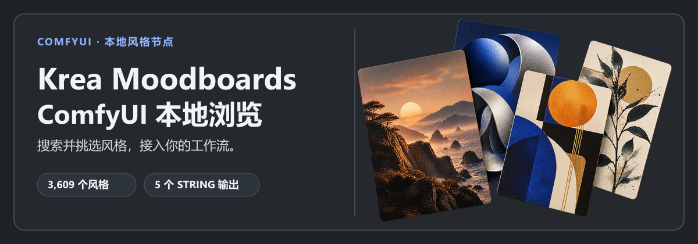

# ComfyUI Krea Moodboards Local



<p align="center"><a href="./README.md">English</a> · <strong>简体中文</strong></p>

在 ComfyUI 中搜索、筛选并选择视觉风格，再把对应的风格提示接入工作流。插件内置 **3,549 个 Krea 情绪板样式**和 **60 个 Andro.Meta 精选风格**。

[原项目：Andro-Meta/ComfyUI-Krea-Moodboards](https://github.com/Andro-Meta/ComfyUI-Krea-Moodboards) · [Krea 情绪板图库](https://www.krea.ai/app?gallery=moodboards) · [数据说明](./DATA_NOTICE.md)

本插件为配合 [ComfyUI-Krea2-Harness 示例工作流](https://github.com/ANe5s/ComfyUI-Krea2-Harness/blob/main/README.zh.md)中的情绪板环节而制作，并支持 ComfyUI 英文和简体中文国际化（i18n）。

封面拼贴为示意素材，不是目录缩略图或节点界面截图。

## 功能

- 搜索样式并按类型筛选；浏览时会继续加载结果。
- 从当前搜索和筛选结果中随机选择，或将喜欢的样式保存在当前浏览器的收藏夹中。
- 界面跟随 ComfyUI 语言设置，支持英文和简体中文国际化（i18n）。插件内置 3,609 条简体中文卡片标题与简介；节点仍输出样式的英文原名。
- 目录随插件提供，不需要安装原项目或额外的 Python 包。

## 环境要求

| 范围 | 要求 |
| --- | --- |
| 本情绪板浏览器 | 可安装自定义节点的 ComfyUI；不需要额外 Python 包。 |
| Krea2 Harness 示例工作流 | Python 3.10+、ComfyUI 0.3.0+，以及支持所需 Qwen3-VL 模型的 `TextGenerate` ComfyUI 构建。 |
| 标准文生图示例 | Krea 2 Turbo 扩散模型、Qwen3-VL 文本编码器和 Qwen Image VAE。其他模型或扩展请查看工作流备注。 |

以上 Python 和 ComfyUI 最低版本来自 Harness 项目说明；本浏览器插件没有单独声明最低版本。

## 安装

在 ComfyUI 安装目录下执行以下命令，安装本插件：

```bash
cd ComfyUI/custom_nodes
git clone https://github.com/ANe5s/ComfyUI-Krea-Moodboards-Local.git
```

如需运行 Harness 工作流，还要在同一个 `custom_nodes` 目录中单独安装 `ComfyUI-Krea2-Harness`：

```bash
git clone https://github.com/ANe5s/ComfyUI-Krea2-Harness.git
```

手动安装时，将两个完整文件夹分别复制到 `ComfyUI/custom_nodes/`。本插件中包含 `__init__.py` 的目录应为 `ComfyUI/custom_nodes/ComfyUI-Krea-Moodboards-Local/`。详细说明见 Harness 的[中文 README](https://github.com/ANe5s/ComfyUI-Krea2-Harness/blob/main/README.zh.md)。

保留插件中的 `data/`、`locales/` 和 `web/` 目录，然后完全重启 ComfyUI。在 **ANe5s Nodes / Krea2** 分类下找到 **Krea Moodboard Visual Browser**。

## 快速开始

1. 从 Krea2 Harness 的 `examples/` 文件夹载入一个示例工作流。
2. 在 **Krea Moodboard Visual Browser** 中搜索或筛选样式，点击卡片或随机选择，然后将 `strength` 设为 `concise`、`normal` 或 `strong`。
3. 将 `positive`、`title`、`uuid` 和 `metadata_json` 接入 **Krea2情绪板转换**；将 `negative` 直接连接到下游负向文本编码节点。
4. 按所选工作流备注加载模型文件，然后运行工作流。

节点只返回 `STRING` 文本，不加载模型、不生成图像，也不输出 conditioning。

### 输出

| 输出 | 类型 | 内容 |
| --- | --- | --- |
| `positive` | `STRING` | 正向风格提示 |
| `negative` | `STRING` | 负向风格提示 |
| `title` | `STRING` | 样式英文原名 |
| `uuid` | `STRING` | 样式 UUID |
| `metadata_json` | `STRING` | 样式元数据，包含来源信息 |

## 本地数据与缩略图

Registry 安装包会为有来源图片的目录条目附带 256 像素 WebP 缩略图，存放在 `data/thumb_cache/`。ComfyUI 从本地磁盘提供图片，浏览目录不会访问 Krea、其 CDN 或翻译服务。60 个 Andro.Meta 提示词主题没有图片。点击卡片上的 Krea 来源链接会在浏览器中打开公开页面。

目录字段、来源和数据细节见 [DATA_NOTICE.md](./DATA_NOTICE.md)。

## 与原项目的关系

本插件为配合 [ComfyUI-Krea2-Harness 示例工作流](https://github.com/ANe5s/ComfyUI-Krea2-Harness/blob/main/README.zh.md)中的情绪板环节而制作。Harness 示例需要单独安装情绪板浏览器，并通过情绪板转换节点读取浏览器的 `positive`、`title`、`uuid` 和 `metadata_json` 输出；`negative` 则直接连接到下游负向文本编码节点。本 Local 实现自带节点、目录文件、浏览器脚本和本地 API，无需安装[原项目](https://github.com/Andro-Meta/ComfyUI-Krea-Moodboards)即可使用，也可与原项目同时安装。

节点类型为 `KreaMoodboardVisualBrowserLocal`。它提供上表中的五个输出，但没有原节点单独的 `url` 和 `preview` 输出端口。若工作流连接了这两个端口，需要调整连线；来源元数据也可从 `metadata_json` 查看。

## 许可

插件依照 [MIT License](./LICENSE) 发布。本插件不是 Krea AI 官方产品，也不代表 Krea AI；目录与 Krea 的关系见 [DATA_NOTICE.md](./DATA_NOTICE.md)。
